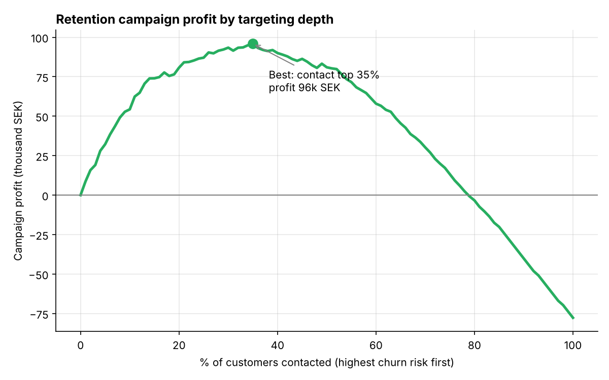
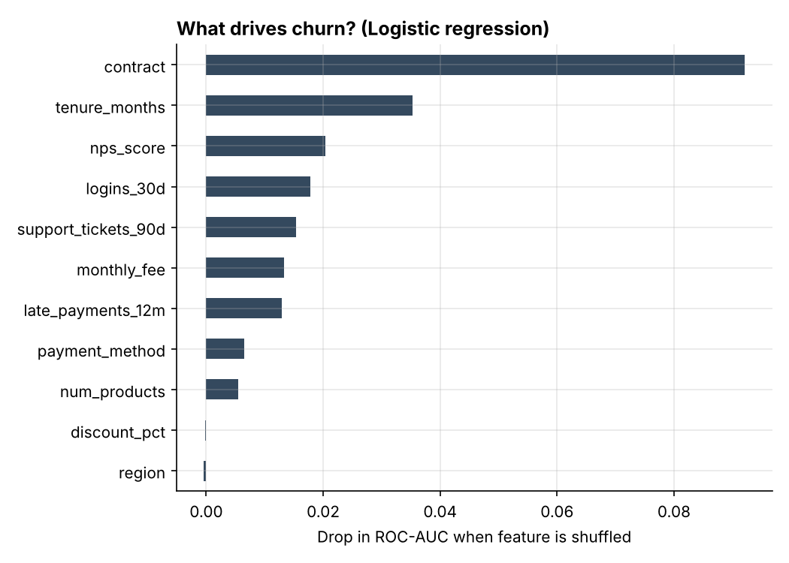
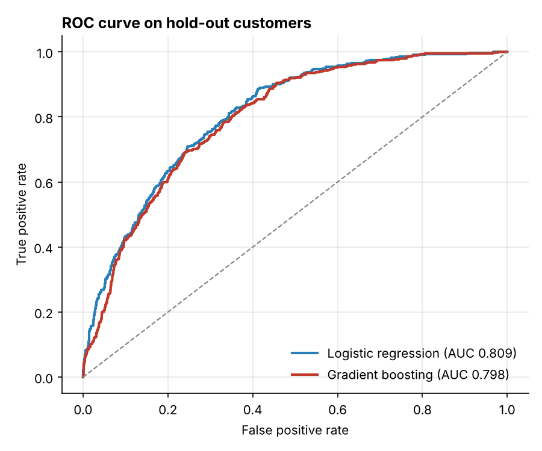

# Customer Churn Prediction & Retention Targeting

An end-to-end machine-learning project for a subscription business. It **predicts which customers
are about to leave** and then answers the question managers actually care about:
**who should we send a retention offer to, so the campaign makes money?**

The workflow goes from data, to model, to explanation, to a business decision. That last step is
where AI creates business value.



## Results

| Model | CV ROC-AUC (5-fold) | Test ROC-AUC | Test PR-AUC | Brier score |
|---|---:|---:|---:|---:|
| **Logistic regression** | **0.813 ± 0.017** | **0.809** | **0.532** | **0.133** |
| Gradient boosting | 0.800 ± 0.018 | 0.798 | 0.492 | 0.137 |

*8,000 synthetic customers, 21.6 % churn rate, 25 % stratified hold-out set.*

**Business outcome on the hold-out set (2,000 customers):**

* Contacting the **35 % highest-risk customers** gives the highest profit: **≈ 96,000 SEK**.
  It reaches 307 of the 432 churners.
* Contacting **everyone** would *lose* ≈ 78,000 SEK, because the offer cost is wasted on loyal customers.
* Assumptions (all configurable): offer cost 200 SEK per customer, 35 % of contacted churners
  are retained, value of a retained customer = 24 months × 40 % margin.

**Why does the simpler model win?** The data has mostly additive, roughly linear effects, so logistic
regression fits it well. It is also easier to explain to a business stakeholder. Gradient boosting
usually wins on messier real-world data, which is why the pipeline compares both and chooses with
cross-validation instead of picking one beforehand.

## What drives churn?



Permutation importance shows that contract type, tenure and customer satisfaction (NPS) matter most.
Region has no effect. That is correct, because region does not influence churn in the data
generator, and it is a useful sanity check that the model is not finding patterns that aren't there.



## How it works

```
churn/
  data.py        synthetic customer generator + customer lifetime value
  model.py       scikit-learn pipelines (scaling, one-hot encoding, classifier),
                 cross-validation, hold-out evaluation, permutation importance
  targeting.py   campaign profit function and profit curve
  __main__.py    runs everything and writes reports/
tests/           pytest suite (7 tests)
```

1. **Data**: `generate_customers()` creates a reproducible dataset of 8,000 customers with contract
   type, tenure, fees, product count, app logins, support tickets, late payments, NPS, discounts,
   payment method and region.
2. **Modelling**: both models are full `Pipeline`s, so preprocessing is fitted only on training
   folds (no data leakage). Models are compared with stratified 5-fold cross-validation.
3. **Evaluation**: ROC-AUC for ranking quality, PR-AUC because churners are the minority class,
   and Brier score for probability calibration.
4. **Decision**: customers are ranked by predicted risk, and for each targeting depth the campaign
   profit is computed as
   `Σ (churned × success_rate × CLV − offer_cost)` over contacted customers.

## Run it

```bash
git clone https://github.com/Tawuf/customer-churn-prediction.git
cd customer-churn-prediction
pip install -r requirements.txt

python -m churn                                   # full pipeline, writes reports/
python -m churn --offer-cost 350 --success-rate 0.25   # what if the offer is pricier?
pytest -q
```

## About the data

The dataset is **synthetic**: generated by `churn/data.py` with a fixed random seed. Real customer
data is confidential and protected by GDPR, so the generator encodes realistic, documented
relationships (for example, monthly contracts and unresolved support tickets increase churn risk).
That way the whole pipeline can be shared and reproduced. Swap in a real dataset with the same
columns and everything else works unchanged.

## Possible extensions

* Uplift modelling, which targets customers whose behaviour the offer actually *changes*.
* Probability calibration with `CalibratedClassifierCV`.
* A small dashboard for the retention team.

## Author

**Md Tawuf Chowdhury**: MSc Information Systems, Uppsala University.

License: MIT
